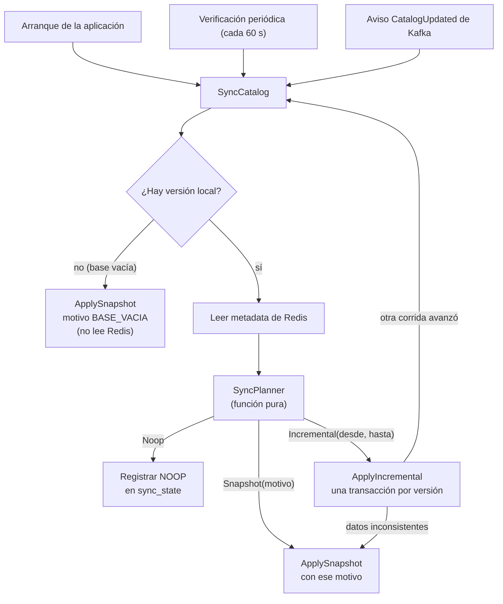

# Sincronización de atlas-catalogo · estrategia, idempotencia y recuperación

**Componente:** atlas-catalogo · **Isla:** 1 · Eolia · **Actualizado:** 2026-10-12 · **Cubre:** issues #15 (snapshot), #17 (cliente Redis), #19 (incremental) y #21 (Kafka)

Este documento describe **cómo funciona hoy** la sincronización de la copia local del catálogo, para quien necesite entenderla, probarla u operarla. Las decisiones de diseño y sus alternativas están en el [ADR 0003](adr/0003-arquitectura.md); lo que se decidió al implementar, en [`implementacion/atlas-catalogo.md`](../implementacion/atlas-catalogo.md); el esquema de datos, en [`modelo-datos/atlas-catalogo.md`](../modelo-datos/atlas-catalogo.md). Si algo de acá contradice al código, el código manda y este documento está desactualizado.

## En una frase

La cátedra es la fuente del catálogo. `atlas-catalogo` guarda una copia local (categorías, profesionales y horarios semanales) y la mantiene al día comparando su **versión local** con la **versión vigente** que publica la cátedra: si no hay copia o no se puede continuar, reconstruye con un **snapshot** (REST); si está atrasada, aplica los **cambios incrementales** de cada versión (Redis); si ya está al día, no hace nada. Kafka solo avisa que hay una versión nueva: nunca decide.

## Piezas y de dónde sale cada dato

| Qué | De dónde | Para qué |
|---|---|---|
| Snapshot completo (`GET /api/synchronization/snapshot`) | REST de la cátedra, con el JWT técnico | Armar o reconstruir toda la copia |
| Metadata de versiones (`catedra:sync:metadata`) | Redis, solo lectura | Saber qué versión es la vigente y cuál la más antigua con cambios |
| Cambios de una versión (`catedra:sync:changes:{v}`) | Redis | Qué IDs cambiaron en la versión `v` |
| Estado vigente de las entidades (Hashes `professional-categories`, `professionals`, `weekly-schedules`) | Redis | Los datos de cada ID afectado |
| Aviso de versión nueva (`CatalogUpdated`) | Kafka, topic del catálogo | Disparar la sincronización sin esperar la verificación periódica |
| Versión local y estado de la corrida | Tabla `sync_state` (una fila) de la base propia | Saber en qué versión está la copia, qué pasó en la última corrida y servir de candado |

## Vista general



Los tres disparadores ejecutan **el mismo caso de uso**. Por eso un aviso duplicado, atrasado o perdido produce el mismo resultado final: lo único que cambia es cuánto tarda la copia en ponerse al día.

## El planificador

Función pura (sin Spring, Redis, REST ni base de datos): recibe la versión local (o ninguna) y la metadata remota (o ninguna) y devuelve el plan. Una prueba por fila en `SyncPlannerTest`.

| # | Condición | Plan |
|---|---|---|
| 1 | No hay versión local (base vacía) | `Snapshot(BASE_VACIA)` |
| 2 | Metadata ausente, ilegible o incoherente (`current < oldest`) | `Snapshot(NO_VERIFICABLE)` |
| 3 | `local > current` | `Snapshot(LOCAL_ADELANTADA)` |
| 4 | `local == current` | `Noop` |
| 5 | `local < oldest` | `Snapshot(FUERA_DE_VENTANA)` |
| 6 | En otro caso (`oldest <= local < current`) | `Incremental(local + 1, current)` |

La fila 5 sigue la lectura literal de la referencia de integración (14.2 y 18.2). Si el docente responde de otra manera la consulta 10, solo cambia esa fila y sus pruebas de borde. Con la base vacía no se lee Redis: la primera carga solo necesita REST.

## Sincronización completa (snapshot)

`ApplySnapshot.run(motivo)` hace todo en **una sola transacción**:

1. Toma la fila de `sync_state` con `SELECT ... FOR UPDATE`: es el candado. Dos corridas no se pisan.
2. Pide el snapshot a la cátedra (con reintentos acotados ante fallas de red, timeout y `503`).
3. Aplica con *upsert* (`INSERT ... ON CONFLICT (id) DO UPDATE`) las categorías, luego los profesionales y luego los horarios, en ese orden por las claves foráneas.
4. Deshabilita (`enabled = false`) lo que existe localmente y no vino en el snapshot. **Nunca borra.** Si una colección viene vacía, se deshabilitan todas las locales de esa tabla.
5. Registra en `sync_state` la versión del snapshot como versión local, aunque sea menor que la anterior (es una reconstrucción), con resultado `SNAPSHOT`, el motivo, la hora y sin error.

El pedido a la cátedra va **dentro** de la transacción a propósito: si se pidiera antes, una corrida lenta podría aplicar su snapshot después de otra más nueva y hacer retroceder la copia. El costo es una conexión de base ocupada mientras dura el pedido (peor caso, unos 91 s).

Si algo falla, la transacción se revierte entera. El error se registra **después**, en otra transacción corta (con el candado ya liberado): `sync_state` queda en `ERROR` con un código y un mensaje corto. La copia queda como estaba.

## Sincronización incremental

`ApplyIncremental` aplica las versiones `desde`..`hasta` **una por una**. Cada versión `v` es su propia transacción:

1. Toma `sync_state` con `FOR UPDATE` y comprueba que `local_version` siga siendo `v - 1`. Si otra corrida avanzó mientras tanto, termina sin error y `SyncCatalog` vuelve a planificar (hasta 3 veces).
2. Lee `changes:{v}` en Redis. Si no existe → escala a snapshot (`FALTA_VERSION`).
3. Lee el estado vigente de cada ID afectado en los Hashes. Los IDs de `changes` que ya no están en el Hash se tratan como en el punto siguiente.
4. **ID ausente:** el primero de la corrida se deshabilita localmente (sin tocar `updated_at`, que son valores de la cátedra) y se avisa en el log: el contrato no lo prevé, pero puede ser una carrera entre la lectura de `changes` y la del Hash. Con un **segundo** ID ausente en la misma corrida, el estado de Redis se considera no verificable: se revierte la versión en curso y se escala a snapshot (`NO_VERIFICABLE`).
5. Aplica con *upsert*, en el mismo orden (categorías, profesionales, horarios), y avanza `local_version` a `v` con resultado `INCREMENTAL`.
6. Al terminar todas las versiones, relee la metadata: si la versión vigente subió, sigue. Hay un **tope por corrida** (1000 versiones por defecto): si faltan más, la siguiente verificación continúa.

Si una versión falla, esa versión se revierte y la versión local **no avanza**; las versiones anteriores de la misma corrida ya aplicadas se conservan (la copia siempre es consistente, porque cada versión es una unidad de trabajo completa).

### Qué escala a snapshot y qué deja un error

| Situación | Resultado |
|---|---|
| Falta `changes:{v}` | Snapshot (`FALTA_VERSION`) |
| Un segundo ID ausente en la corrida | Snapshot (`NO_VERIFICABLE`) |
| Una referencia rota al aplicar (por ejemplo, un horario de un profesional que no existe) | Snapshot (`NO_VERIFICABLE`) |
| Datos de Redis que no se pueden interpretar (metadata, `changes` o entidades con JSON inválido o sin campos obligatorios) | Snapshot (`NO_VERIFICABLE`) |
| Redis o la cátedra no responden, o rechazan la credencial | **Error**, sin snapshot |
| Falla de aplicación que no es de datos (por ejemplo, la base de datos) | **Error** (`INCREMENTAL_NO_APLICABLE`), sin snapshot |

La regla es: **se escala cuando un snapshot arregla el problema; no se escala por una falla transitoria**, porque reconstruir toda la copia no ayuda si la cátedra no está. Un disparo nunca encadena más de un snapshot: si el de escalada falla, la corrida termina con el error.

## Disparadores

| Disparador | Cuándo | Propiedades |
|---|---|---|
| Arranque | Al terminar de arrancar. Con la base vacía arma la copia; con versión local recoge lo que se perdió con la aplicación apagada. Si la cátedra falla, la aplicación arranca igual. | `atlas.sync.on-startup` |
| Verificación periódica | Cada intervalo, con **espera fija** entre el fin de una corrida y el comienzo de la siguiente (nunca se superponen). La primera espera un intervalo. Recupera avisos perdidos y mantiene la copia al día aunque Kafka no funcione. | `atlas.sync.periodic-check`, `atlas.sync.check-interval` (60 s) |
| Aviso de Kafka | Por cada `CatalogUpdated`. Despierta la sincronización; su `newVersion` solo va al log. | `atlas.sync.kafka.enabled` |

### El consumidor de Kafka

- Solo se interpretan `eventType = CatalogUpdated` y `newVersion`; el resto se ignora. Un mensaje sin valor, ilegible, de otro tipo o sin `newVersion` se registra (sin su cuerpo) y se descarta con su *offset* confirmado: no bloquea el consumo.
- El *offset* se confirma **solo después de que la corrida terminó sin excepción** (`MANUAL_IMMEDIATE`, un mensaje por vez).
- Si la corrida falla, el mensaje se reintenta con espera creciente (3 intentos en total, esperas de 1 s y 2 s) y, al agotarlos, se descarta con el *offset* confirmado: el error ya quedó en `sync_state` y la verificación periódica lo reintenta sola, así que no se pierde información y el consumidor no se traba.
- La aplicación arranca aunque Kafka no responda, incluso si los servidores no se resuelven: el arranque del consumidor se reintenta en segundo plano.
- Un grupo sin *offset* confirmado empieza por lo último (`latest`); con *offset*, retoma desde ahí.

## El estado de la sincronización (`sync_state`)

Una sola fila. Mientras no exista un endpoint de estado (ítem 12 del backlog), se consulta con SQL:

```sql
SELECT local_version, status, last_result, last_snapshot_reason, last_sync_at,
       last_error_code, last_error_message, last_error_at
FROM sync_state;
```

| Columna | Qué dice |
|---|---|
| `local_version` | Versión en la que está la copia. `NULL` = base vacía. |
| `status` | `IDLE` (última corrida bien o aún sin corridas) o `ERROR` (la última corrida falló). `RUNNING` no se escribe: mientras una corrida está abierta nadie ve el cambio y el candado ya excluye a otras. |
| `last_result` | Lo que hizo la última corrida terminada bien: `NOOP`, `INCREMENTAL` o `SNAPSHOT`. |
| `last_snapshot_reason` | Por qué se armó o reconstruyó la copia la última vez con un snapshot (`BASE_VACIA`, `NO_VERIFICABLE`, `LOCAL_ADELANTADA`, `FUERA_DE_VENTANA` o `FALTA_VERSION`). Se conserva en las corridas siguientes. |
| `last_sync_at` | Hora de la última corrida terminada bien (incluidas las verificaciones sin cambios). |
| `last_error_code`, `last_error_message`, `last_error_at` | El error vigente, o `NULL` si no hay. Un éxito posterior lo limpia. |

### Códigos de error

| Código | Mensaje en `sync_state` | Causa típica |
|---|---|---|
| `CATEDRA_NO_DISPONIBLE` | La cátedra no respondió | Red, timeout o `5xx` en REST; Redis caído |
| `CATEDRA_CREDENCIAL_RECHAZADA` | La cátedra rechazó la credencial | `401` o `403` en REST; `WRONGPASS`, `NOAUTH` o `NOPERM` en Redis |
| `CATEDRA_RESPUESTA_INVALIDA` | La respuesta de la cátedra no se pudo interpretar | Cuerpo ilegible o campos obligatorios ausentes en REST |
| `SNAPSHOT_NO_APLICABLE` | El snapshot no se pudo aplicar a la copia local | Falla al aplicar el snapshot (por ejemplo, la base de datos) |
| `INCREMENTAL_NO_APLICABLE` | Los cambios incrementales no se pudieron aplicar a la copia local | Falla de aplicación que no es de datos |

Los mensajes son **fijos por código**: nunca incluyen secretos, hosts ni detalles internos. El detalle va al log del servicio, sin credenciales.

## Concurrencia y exclusión mutua

Una sola corrida a la vez, aunque coincidan el arranque, la verificación periódica y un aviso de Kafka: todas toman `sync_state` con `FOR UPDATE`. La segunda espera el candado; cuando lo obtiene, vuelve a comprobar la versión y, si la primera ya dejó la copia al día, termina en `Noop` (las pruebas de paralelismo lo comprueban). Por diseño vale también para varias instancias del servicio contra la misma base, porque el candado vive en la base; las pruebas lo ejercitan con dos hilos de una misma instancia, no con dos instancias.

## Idempotencia

Repetir cualquier operación deja la copia igual. Se logra con dos mecanismos: los *upserts* por ID de la cátedra (clave primaria, `ON CONFLICT DO UPDATE`) y la comparación de versiones antes de aplicar nada.

| Situación | Resultado | Prueba |
|---|---|---|
| El mismo snapshot dos veces | Sin filas duplicadas ni cambios | `SincronizacionCompletaTest.repetirElSnapshotNoDuplicaNiCambiaLosDatos` |
| Una versión incremental ya aplicada, reaplicada | Misma copia, misma versión | `SincronizacionIncrementalTest.reaplicarUnaVersionYaAplicadaDejaLaCopiaIgual` |
| Una segunda corrida con la copia al día | `Noop`, sin pedir `changes` | `SincronizacionIncrementalTest.unaSegundaCorridaConLaCopiaAlDiaNoHaceNadaYRegistraNoop` |
| Un `CatalogUpdated` duplicado, atrasado o con una versión que Redis todavía no publicó | `Noop`, *offset* confirmado | `ConsumidorKafkaTest.duplicadosAtrasadosYAdelantadosTerminanEnNoopSinAlterarLaCopia` |
| Dos corridas en paralelo | Se serializan; la segunda replanifica y termina en `Noop` | `SincronizacionIncrementalTest.dosCorridasEnParaleloSeSerializanYLaSegundaVuelveAPlanificar` y `SincronizacionCompletaTest.dosCorridasEnParaleloSeSerializan` |
| Una baja repetida | Sin efecto (`UPDATE ... WHERE enabled`: solo toca lo que sigue habilitado) | Indirecta: `SincronizacionCompletaTest.reconstruyeConValoresNuevosYDeshabilitaLoQueYaNoViene` y `unaColeccionVaciaDeshabilitaTodasLasLocalesDeEsaTabla` |

No se guarda ninguna tabla de `eventId` procesados: la comparación de versiones ya hace de idempotencia.

## Fallas y recuperación

| Falla | Qué pasa | Estado de la copia | Cómo se recupera |
|---|---|---|---|
| La cátedra (REST) no responde | Reintentos acotados; si siguen fallando, la corrida termina con `CATEDRA_NO_DISPONIBLE` | Intacta | La siguiente verificación periódica reintenta sola |
| Redis no responde | `CATEDRA_NO_DISPONIBLE`, **sin** snapshot | Intacta | La siguiente verificación periódica |
| La credencial se rechaza (token vencido, contraseña rotada) | `CATEDRA_CREDENCIAL_RECHAZADA`, sin reintentos | Intacta | Rotar el valor en el `.env` y **reiniciar**: las credenciales se leen al arrancar |
| La respuesta de la cátedra no se puede interpretar | `CATEDRA_RESPUESTA_INVALIDA` (REST) o escalada a snapshot (Redis) | Intacta | Cuando la cátedra publique datos válidos |
| Kafka no responde | La aplicación arranca igual; el consumo se reanuda cuando vuelve | Sin efecto | La verificación periódica cubre mientras tanto |
| Se pierde un aviso de Kafka | No se nota | Atrasada hasta el próximo intervalo | La verificación periódica |
| La cátedra publicó con la aplicación apagada | Al arrancar se verifica | Se pone al día | El arranque |
| Falta `changes:{v}` o un dato inconsistente | Escala a snapshot | Consistente (las versiones anteriores quedan aplicadas) | El snapshot la reconstruye |
| Falla a mitad de una versión o de un snapshot | Rollback de esa unidad de trabajo | Como antes de empezar esa versión o ese snapshot | La siguiente corrida reintenta |
| Mensaje de Kafka corrupto | Se registra y se descarta | Sin efecto | No hace falta |
| Falla de la base de datos | La corrida falla; el error puede no poder registrarse y queda en el log | Sin cambios (la transacción no se confirmó) | La siguiente verificación |
| Corte del proceso a mitad de una corrida | PostgreSQL revierte la transacción abierta | Como antes de la corrida | Al reiniciar, el arranque verifica. *No hay una prueba con un corte real del proceso: es consecuencia de la transacción.* |

Las pruebas que cubren estas filas están en `SincronizacionCompletaTest`, `SincronizacionIncrementalTest`, `SincronizacionConRedisRealTest`, `ConsumidorKafkaTest` y `ConsumidorKafkaInaccesibleTest`, más las pruebas de los clientes (`CatedraRestSnapshotSourceTest`, `CatedraRedisChangeSourceTest`).

## Parámetros

Todos son variables de entorno con un valor por defecto, salvo las obligatorias. La tabla completa está en el README del servicio; estos son los que gobiernan la sincronización:

| Variable | Por defecto | Efecto |
|---|---|---|
| `ATLAS_SYNC_ON_STARTUP` | `true` | Sincroniza al terminar de arrancar |
| `ATLAS_SYNC_PERIODIC_CHECK` | `true` | Enciende la verificación periódica |
| `ATLAS_SYNC_CHECK_INTERVAL` | `60s` | Espera entre verificaciones |
| `ATLAS_SYNC_MAX_VERSIONS_PER_RUN` | `1000` | Versiones máximas por corrida |
| `ATLAS_SYNC_KAFKA_ENABLED` | `true` | Enciende el consumidor del aviso de Kafka |
| `CATEDRA_REST_*`, `CATEDRA_REDIS_*`, `CATEDRA_KAFKA_*` | ver README | Conexión, timeouts y reintentos de cada cliente |

## Limitaciones conocidas

- **La cátedra real solo publica la versión 1.** El snapshot, la metadata y la lectura de `changes:1` se verificaron contra la cátedra real ([evidencias](../evidencias/)); la **aplicación de una versión incremental, las bajas y las escaladas** están cubiertas por pruebas automatizadas con Redis real en un contenedor, no por una versión real de la cátedra. Hay que repetir la verificación cuando se publique una versión 2.
- **Fila 5 del planificador** (`local < oldest`): lectura conservadora hasta la consulta 10. Puede pedir un snapshot que un incremental habría evitado; con este catálogo (unos 14 KB) es barato.
- **Demora de un aviso fallido:** si un aviso de Kafka no se pudo procesar y se descartó, la copia se pone al día en el siguiente intervalo de verificación, no al instante.
- **Una escritura corta por verificación:** una verificación sin cambios se registra como `NOOP`, así que hay una escritura con candado por intervalo (una por minuto por defecto).
- **Sin heurística por tamaño del salto:** si la copia quedó muchas versiones atrás, se aplican una por una hasta el tope por corrida; no se cambia a snapshot por "salto grande".
- **Conexión de base ocupada** durante las lecturas a REST (peor caso unos 91 s) y a Redis dentro de la transacción de cada versión.
- **El estado no se expone por API todavía:** se consulta con SQL hasta que se implemente el ítem 12. Tampoco hay `RUNNING`.
- **Credenciales leídas al arrancar:** rotar un token o una contraseña exige reiniciar el servicio.
- **Kafka sin autenticación:** la cátedra no la documenta y la conexión real funcionó sin credenciales (consulta 11 al docente).
